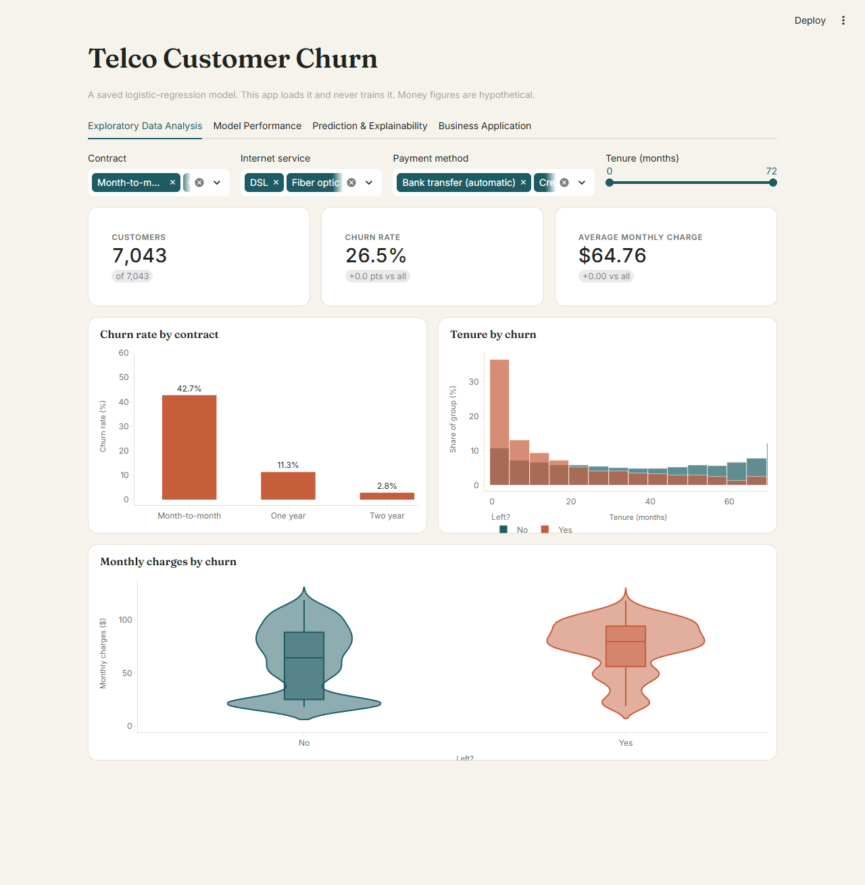
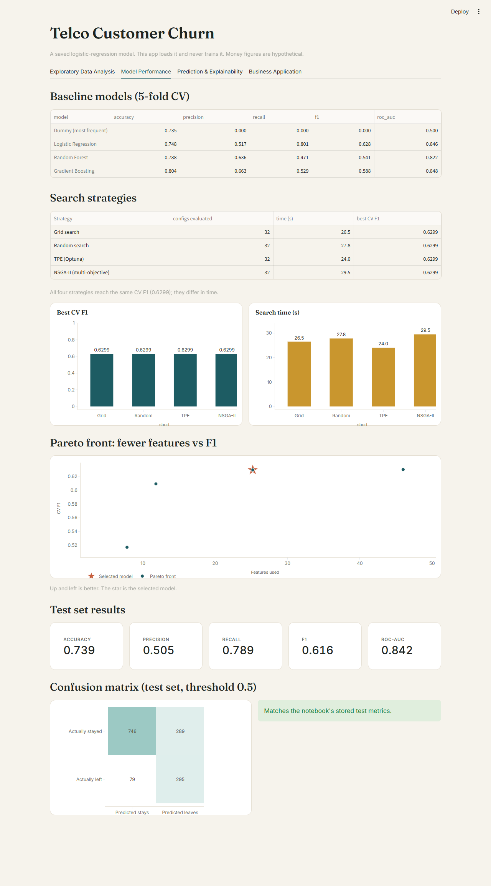
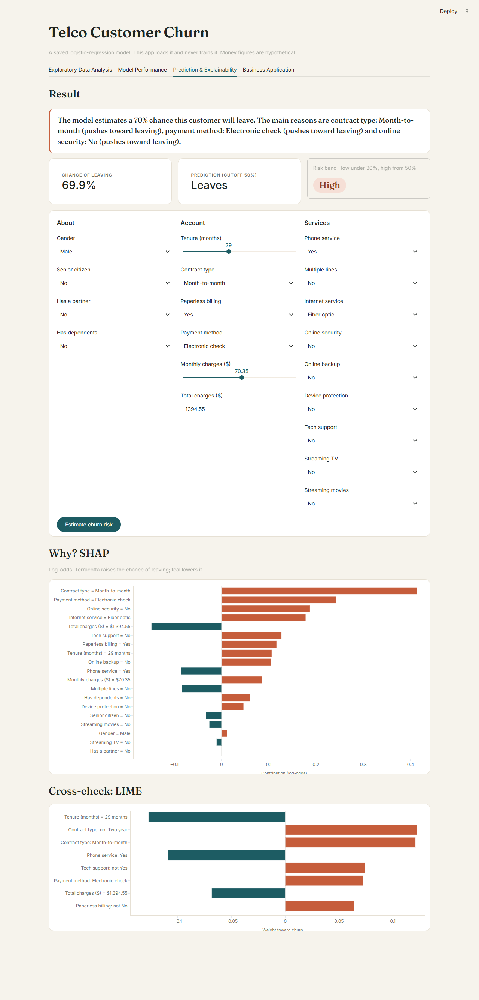
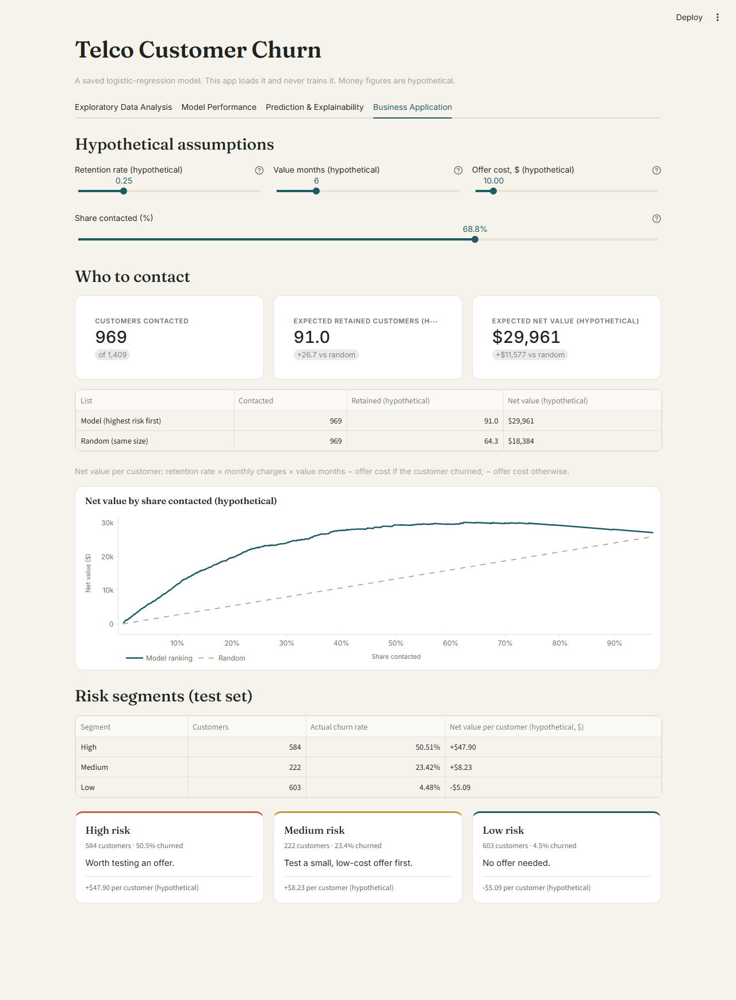
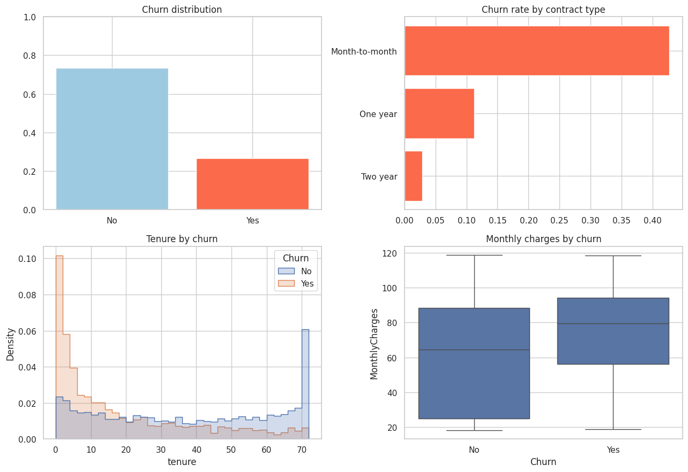
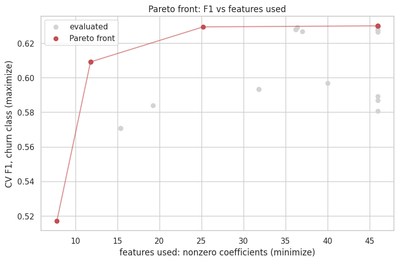
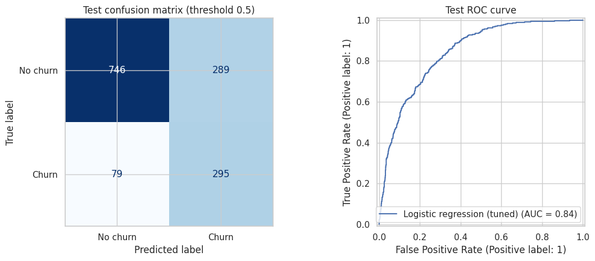
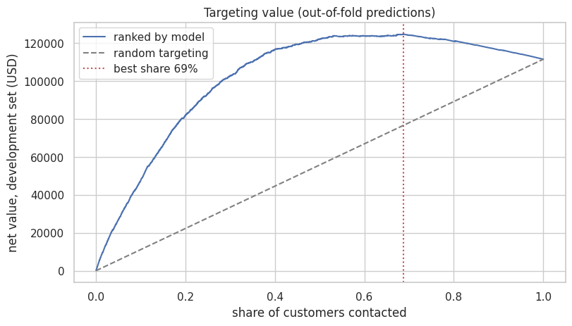
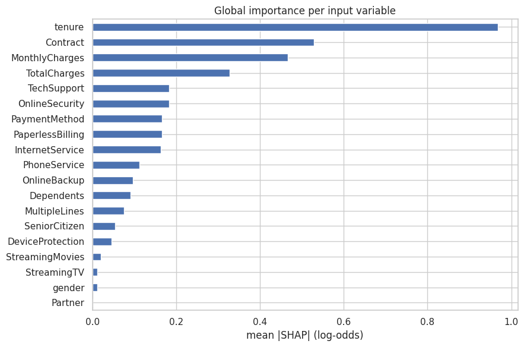

# Telco Customer Churn

A Streamlit app for a machine learning course project. It loads a logistic-regression model trained in a notebook and shows the data, the model's evaluation, per-customer explanations (SHAP, LIME) and a hypothetical business case. It never trains or refits the model.

**Live app:** _add the Streamlit Community Cloud URL_
**Repository:** _add the GitHub URL_

## Screenshots

| Tab | Preview |
|---|---|
| Exploratory Data Analysis | [](docs/screenshots/app_1_exploratory_analysis.png) |
| Model Performance | [](docs/screenshots/app_2_model_performance.png) |
| Prediction & Explainability | [](docs/screenshots/app_3_prediction_explainability.png) |
| Business Application | [](docs/screenshots/app_4_business_application.png) |

## Key figures from the notebook











## Run locally

Requires Python 3.12.

```bash
python -m venv .venv
```

```bash
.venv\Scripts\activate
```

macOS/Linux: `source .venv/bin/activate`

```bash
pip install -r requirements.txt
```

```bash
streamlit run app.py
```

Open http://localhost:8501.

## Deploy to Streamlit Community Cloud

1. Push this folder to a GitHub repository.
2. On [share.streamlit.io](https://share.streamlit.io), click **Create app**.
3. Choose the repository, set the main file to `app.py`, and pick Python 3.12.
4. Paste the app URL at the top of this README.

## Project layout

| Path | Contents |
|---|---|
| `app.py` | Interface: four tabs |
| `churn_lib.py` | Loading, prediction, SHAP, LIME, business maths |
| `ui.py` | Styling and chart theme |
| `artifacts/` | Saved pipeline, metadata and result tables from the notebook |
| `data/` | Raw Telco dataset |
| `tests/acceptance_check.py` | Acceptance checks |

## Tests

```bash
python tests/acceptance_check.py
```

Runs the real app and checks it against the saved model. All 19 checks pass.

## Notes

- scikit-learn is pinned to 1.6.1, the version that saved the model.
- The final model is L1 (C = 0.3). It keeps 25.2 features on average across CV folds, against 46 for the best L2 setting, and loses 0.0006 CV F1.
- Money figures are hypothetical assumptions, not results.
- The test set is used only for the final evaluation and the business ranking. Nothing selects a setting from it.
- SHAP and LIME show what the model associates with leaving, not what causes it.
